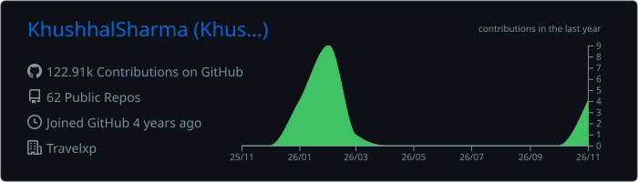
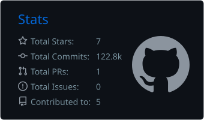
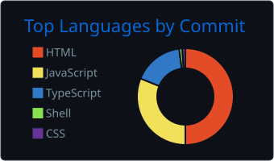

  
  
  
  

  
  
  

## About

I build and ship the frontends of a global travel and OTT platform: streaming on web and smart TVs, flight, hotel and holiday booking, payments, and the CMS behind them. I've led the frontend team at [Travelxp](https://www.travelxp.com/en) since June 2024.

- 📍 **Location:** Mumbai, India
- 💼 **Experience:** 3.5 years at Travelxp. Frontend Developer L3, Team Lead since June 2024
- 🎓 **Education:** BA, Kurukshetra University · Full stack bootcamp, Sharpener
- 🌱 **Learning:** Three.js, advanced GSAP motion, and AI-assisted product features
- ⚡ **Fun fact:** I write code to rap and train at the gym every day

## Impact

| | |
|:--|:--|
| **693K+** | subscription orders through the platform, most through JioTV |
| **314K+** | registered users on the products I build |
| **700+** | routes in the main web app |
| **86 → 1** | class-based files left after leading the move to functional React |
| **2.5K → 9.4K** | yearly flight bookings, 2023 to 2025 |

## Stack

**Languages** 

**Frontend** 

**Backend and databases** 

**Tools and deployment** 

## Live work

| Product | What it is |
|:--|:--|
| [travelxp.com](https://www.travelxp.com/en) | Travel OTT, booking and payments web app |
| [Travelxp on iOS / tvOS](https://apps.apple.com/in/app/travelxp-travel-shows-in-4k/id1274547336) · [Android](https://play.google.com/store/apps/details?id=com.travelxp&hl=en_IN) | Streaming apps |
| [foodxp.com](https://www.foodxp.com/en) | Food OTT platform |
| [quests.travel](https://www.quests.travel/) | Travel experiences |

The case studies (architecture, incidents and results) are on my **[portfolio →](https://khushhal-portfolio.vercel.app/?utm_source=github)**

## Languages

| | |
|:--|:--|
| 🇬🇧 English |  |
| 🇮🇳 Hindi |  |

## GitHub stats

  

  
  

Most of my production code is in private company repositories. The repos here are personal projects.

<picture>
  <source media="(prefers-color-scheme: dark)" srcset="https://raw.githubusercontent.com/KhushhalSharma/KhushhalSharma/output/github-contribution-grid-snake-dark.svg" />
  
</picture>

